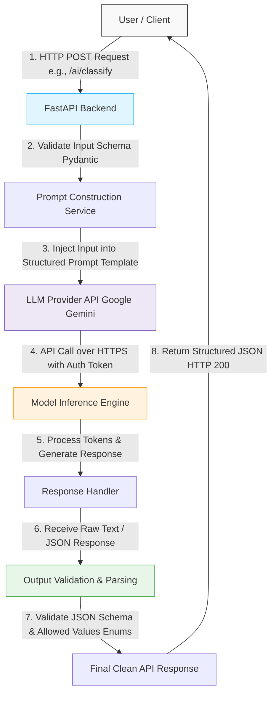

# 🔄 LLM Request Lifecycle & Architecture

---

## 📊 End-to-End Request Flow Diagram

---

## 🛠️ Component Roles & Explanations

### 1. User / Client
* **Role:** Triggers the system execution.
* **Description:** Initiates an asymmetric request payload via a secure `HTTP POST` request to a specific endpoint (e.g., `/ai/classify` or `/ai/extract`).

### 2. FastAPI Backend
* **Role:** Security, gateway enforcement, and protocol handling.
* **Description:** Acts as the primary interface layer. It manages routing, enforces application middleware (like CORS policies and rate limits), and uses **Pydantic** models to rigorously typecheck incoming request bodies. If a client payload fails validation here, it halts execution immediately with an explicit `HTTP 422 Unprocessable Entity` error.

### 3. Prompt Construction Service
* **Role:** Deterministic context assembly.
* **Description:** Isolates user inputs from the direct instruction layers. This service safely injects variables into rigid, version-controlled system prompt templates to prevent prompt injection attacks and provide structural guardrails for the underlying model.

### 4. LLM Provider API (Google Gemini)
* **Role:** Network serialization and token routing.
* **Description:** Translates internal application payloads into network requests targeting Google's Gemini infrastructure. It injects active `GEMINI_API_KEY` configurations, handles connection timeouts, and routes payloads cleanly using the official Google GenAI SDK architecture.

### 5. Model Inference Engine
* **Role:** Probabilistic machine learning compute.
* **Description:** Executed entirely on Google's cloud-hosted infrastructure. The core engine ingests the context, converts characters to vector tokens, routes calculations through the model weights, and iteratively predicts the mathematical sequence of response tokens.

### 6. Response Handler
* **Role:** Network streaming or block resolution.
* **Description:** Receives incoming network chunks or completed unary bodies returned by the Google API. It converts network stream protocols into a clean string or primitive JSON data type block while intercepting premature connection failures.

### 7. Output Validation & Parsing
* **Role:** Structural assertion and reliability enforcement.
* **Description:** Evaluates the unstructured text response. It attempts to parse raw strings into targeted **Pydantic schemas**, verifying that keys exist and that string tokens conform to programmatic application invariants like fixed **Python Enums**.

### 8. Final Clean API Response
* **Role:** Synchronous client handoff.
* **Description:** Standardizes output structure. It wraps the fully validated data objects into a finalized web frame, returning a structured `HTTP 200 OK` JSON response seamlessly back down the network connection to the client runtime.
